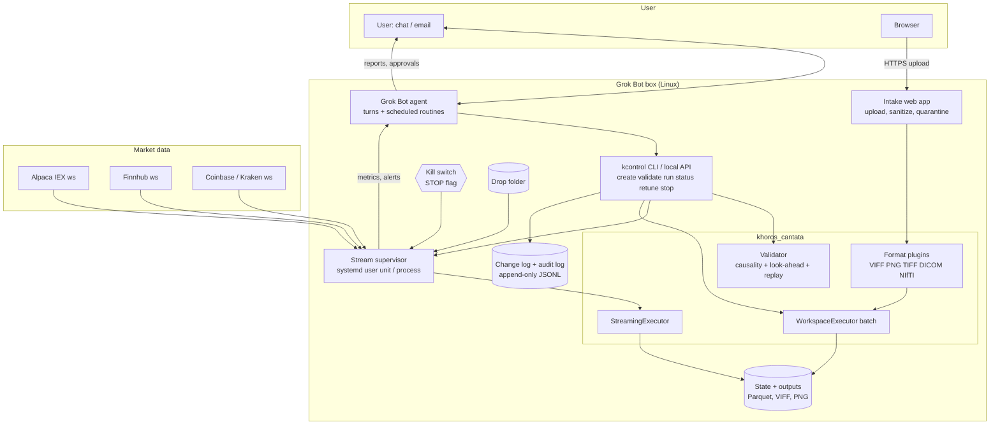
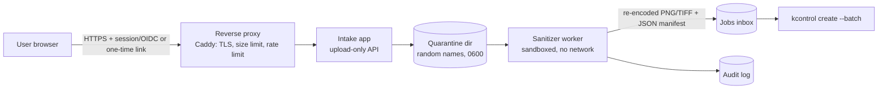

# 1. Summary

**Goal.** Add Grok Bot, an agent with its own Linux box, shell, browser, scheduled routines, chat and email, as a participant in the analysis stream. It would build, validate, run, monitor, retune and explain Khoros-style dataflow workspaces (`.wk`) for (A) market-data streams and (B) image processing. (C) assesses medical-image (DICOM) support.

**Key recommendations**

1. **Put a narrow control layer in front of the engine:** a `kcontrol` CLI plus an equivalent local JSON API. The agent drives everything through it (create → validate → dry-run → run → status → retune → stop). It never edits engine code at runtime and never runs workspaces some other way. Every action goes to an append-only change log.
2. **Default autonomy: observe, retune within limits, alert.** No order routing exists in the design. A future paper-trading sink is the most it would ever get. Live trading is out of scope and would need a separate decision. Retunes outside pre-approved parameter ranges need the user's approval in chat. A kill switch (file flag + CLI + chat command) stops every stream.
3. **Gate every deploy:** the streaming executor's causality check (non-causal glyphs rejected unless wrapped in `krolling`), plus a `find_lookahead` perturbation test on recorded data, plus stream-vs-batch equality on a replay. These checks already exist on the `operators` branch.
4. **Data sources:** start with **file drops** (CSV/Parquet in a watched folder) and the **Alpaca free IEX websocket** (or **Finnhub free websocket**) for live equities. Use **Coinbase/Kraken public websockets** for 24/7 crypto testing. Polygon/Massive's free tier has no real-time data. IEX Cloud no longer exists (shut down Aug 2024).
5. **Image intake:** a small **local upload web app** ("Intake"), not a browser extension, in the MVP. It is upload-only (no URL fetching, so no SSRF), with authentication, TLS, magic-byte type checks, a size/pixel cap, re-encoding to strip EXIF/metadata, quarantine and an audit log. A file-share drop folder goes through the same sanitizer.
6. **DICOM verdict: feasible, moderate complexity.** Two days for a read-only single-frame/multi-frame loader into VIFF (prototype done, see §6.8). About 3–5 weeks for a robust, pluggable medical format layer: compressed transfer syntaxes, series → volume assembly with orientation, de-identification, NIfTI. Regulatory/HIPAA work is separate and must be scoped by the user's organization. Recommend **de-identified/public data only** until then.

**Honest limits.** The engine is a ~2k-line reconstruction plus a new operator library, with no GUI. Operator semantics were rebuilt from general Khoros conventions, not checked against the original programs. The streaming executor is single-process and Python-speed: fine for bars and ticks on tens of symbols, not for full-market tick data or HFT. The agent works in turns and scheduled routines; it is not a hard-real-time supervisor. Sub-second alerting has to come from the stream process itself, with the agent handling escalation and retuning.

# 2. Current state (grounded in the code)

| Component | Where | What exists now |
|---|---|---|
| Workspace format `.wk` | `khoros_cantata/workspace_runtime.py` | `Glyph:TB:op::ID:X:Y:VARS: -opt val` lines, `NodeConnection:out:port:in:port:`, variables block. Parser handles Khoros 1 and 2.x dialects. |
| Batch executor | `WorkspaceExecutor`, `NativeOperatorRegistry` | Runs whole records through the graph. Fan-out supported. Ports `i`, `i1/i2`, `o`, `o2…`. |
| Operator library | `ops_signal`, `ops_image`, `ops_datamanip`, `operators.py` | 86 of the 134 historical operators (80 new + 6 pre-existing), plus 46 extended ones (EMA, FIR/IIR, Hilbert, wavelets, morphology…). `OPERATORS_STATUS.md`. |
| Streaming executor | `khoros_cantata/streaming.py` | `StreamingExecutor.push()/run()/reset()`. `StreamOp` interface. Streamable/non-causal declarations. `STREAM:kinput/koutput/krolling`. `find_lookahead`/`assert_no_lookahead`. `batch_execute`. |
| Data model | `viff.py`, `ops_common.py` | VIFF 5-D (w,h,d,t,e) value segment + mask/map/location/time segments. Operators preserve attributes. |
| Trading toolkit | `/workspace/signal-trading/src/signal_trading/` | `data` (CSV, yfinance, synthetic), `bars`, `streaming` (EMA, FIR, IIR, Kalman, rolling z), `strategies`, `backtest`, `spectral`, `khoros_adapter` (SIGTRADE ops + `stream_executor`). |
| Example | `examples/streaming_ema_crossover.wk` | price → EMA10/EMA40 → `kcross` → signal. Streaming result equals batch. |

**Gaps this plan fills:** no process supervisor or long-running service; no live-feed adapters; no persistence of stream state or outputs; no image file readers (VIFF only, no PNG/JPEG/TIFF/DICOM); no control API; no explanation generator; no auth/TLS anywhere. These projects stay separate: the engine (`khoros-cantata-python`) gains generic pieces (control layer, format plugins). Trading-specific adapters stay in `signal-trading`.

# 3. Architecture



*Text version (in case the diagram does not render):* User ⇄ Agent → `kcontrol` → Validator → (Supervisor → StreamingExecutor ← live feeds / drop folder) or (Batch executor ← format plugins ← Intake app). Outputs go to the state store; metrics flow back to the agent, and reports and approval requests go to the user. Every control action is logged, and the kill switch overrides the supervisor.

**Process model.** Each running stream is one supervised process (`kcontrol run` spawns `kstream-worker <stream-id>`, managed as a systemd user unit or a simple PID file). It owns the feed connection, the `StreamingExecutor`, periodic state snapshots and a metrics file (`status.json`, updated every N seconds). The agent never holds a stream in its own turn. It reads status, and scheduled routines poll it (e.g. every 5–15 min during market hours) and on alert files.

# 4. Agent control interface

One CLI (`kcontrol`) and the same operations as a local HTTP/JSON API, bound to `127.0.0.1` only, for the agent's tools. All commands are idempotent where possible, return JSON, and log to `~/.khoros/streams/<id>/changes.jsonl`.

| Command | Purpose | Notes |
|---|---|---|
| `kcontrol create <id> --from template.wk` or `--spec spec.yaml` | Create a stream or batch job from a template or a declarative spec | The spec lists sources, glyphs, params, sinks. The CLI writes the `.wk`. The agent edits the spec, not raw `.wk` text. |
| `kcontrol validate <id>` | Parse; operator existence; port typing; **causality** (`classify`); **look-ahead** test on replay data; **stream == batch** check on a replay; param bounds | Produces `validation.json`. Required before `run`. |
| `kcontrol dryrun <id> --replay file.parquet` | Replay recorded data through the stream | Outputs, signals and latency stats. |
| `kcontrol run <id> [--paper]` | Start the supervised worker | Refuses if validation is missing or stale (workspace hash mismatch), or the STOP flag is set. |
| `kcontrol status [<id>]` | Health: feed connected, last tick age, samples/s, latency p50/p99, errors, last signals, param set | Reads `status.json`. |
| `kcontrol retune <id> --set kema#2.span=15 [--reason ...]` | Hot parameter change | Within the approved envelope: apply at the next sample boundary (rebuild that glyph's state, optionally warm-started by replaying the last N samples). Outside it: create a pending approval. |
| `kcontrol approve <change-id>` / `reject` | Human approval of pending changes | Only via the user's chat confirmation. The agent cannot self-approve (separate token held in the user's channel). |
| `kcontrol explain <id> [--format md or svg]` | Generated graph documentation (see §5) | |
| `kcontrol stop <id>` / `kcontrol stop --all` | Graceful stop; snapshot state | `--all` = kill switch. Also `touch ~/.khoros/STOP`. |
| `kcontrol logs <id> --since 1h` | Change, audit and error logs | |
| `kcontrol report <id> --period day` | Summary for chat/email | Signals, drift, retunes, incidents. |

**Retune semantics (design detail).** A retune is a new workspace version (`v7 → v8`) with a diff, a reason and a validation result. Glyph state is reset for changed glyphs only. Downstream glyphs are not reset but are flagged "transient" for a warm-up of `k` samples, where `k` is the larger of the changed operator's window/span and 3× its time constant. Signals during warm-up are tagged and not alerted on.

# 5. How the agent explains each graph

Each `.wk` produced by the agent carries an `#AnnotationsBegin` block and a sidecar `README.md` generated by `kcontrol explain` from the operator metadata. To support this, each operator gets a docstring-derived description, an input/output contract, a causal/non-causal flag and a "why" field the agent fills in. The explanation contains:

1. **Purpose** (one paragraph, from the user's goal).
2. **Graph diagram:** a Mermaid flowchart produced automatically from the glyphs and connections (node label = `op` + key params).
3. **Per-glyph table:** operator, parameters with units (e.g. EMA span 10 bars ≈ 4.5-bar lag), why this choice, causal yes/no, and its warm-up length.
4. **Data contract:** input sampling, units, axis meaning (VIFF w,h,d,t,e), and output meaning.
5. **Validation evidence:** causality report, look-ahead test result, stream-vs-batch max difference, replay metrics.
6. **Known limitations** (e.g. "`krolling` around `kiir -zerophase` is causal but no longer zero-phase; 32-sample window").
7. **Change history:** versions with diffs and who approved them.

# 6. Use case A: stream management

## 6.1 Flow

1. The user asks (chat), e.g. "Watch SPY and QQQ 1-minute bars; alert me on EMA 10/40 crosses and on volatility spikes."
2. The agent writes a spec and runs `kcontrol create`. The graph is built from causal glyphs: `kinput` → bars → `kema`×2 → `kcross`; `klogret` → `krunstats -stat std -window 30` → `kcompare` threshold → `koutput`.
3. `validate` + `dryrun` on the last 5 trading days of recorded data. The agent posts the explanation and dry-run results to chat.
4. With user approval of the initial deployment, `run`. A scheduled routine checks `status` and turns alerts into chat/email messages.
5. Retuning: the agent proposes changes based on drift metrics (e.g. signal rate, false-cross rate on replay). Changes within the envelope are auto-applied and reported. Changes outside it go to an approval request.
6. Daily/weekly report.

## 6.2 Live data sources (checked Oct 30, 2026 via vendor docs and comparison sites; re-check before signup)

| Provider | Free tier | Real-time streaming | Paid entry | Fit |
|---|---|---|---|---|
| **Alpaca Market Data** | Basic: free with an Alpaca (paper) account | WebSocket, **IEX only**, **30 symbols**; historical 200 req/min; latest 15 min of SIP history restricted | Algo Trader Plus **$99/mo**: all US exchanges (SIP), unlimited symbols, 10k req/min | **Recommended MVP live feed.** Paper-trading account included, useful for a later paper sink. IEX is roughly 2–3% of volume, so prices are indicative. |
| **Finnhub** | Free: 60 calls/min | WebSocket trades, **50 symbols** (free) | Market Data Basic about **$49.99/mo** (150 calls/min, 250 ws symbols) | Good alternative/backup; also news/fundamentals. |
| **Polygon.io (rebranded Massive, 2026)** | Basic: 5 calls/min, **end-of-day only**, no real-time | Real-time ws from about $79/mo (IEX) / about $199/mo (SIP); Starter about $29/mo is 15-min delayed | | Good for history/flat files if budget allows; not for free live use. |
| **Coinbase Advanced Trade / Exchange ws**, **Kraken ws** | Free public market-data websockets (no key for public channels) | Ticker/trades/L2 for crypto, 24/7 | | **Best for continuous testing** of streaming (weekends, nights). |
| **Tiingo**, **Twelve Data**, **Alpha Vantage** | Free tiers with low daily/minute caps | Limited or paid websockets | Low-cost paid tiers | Secondary/backfill only. |
| **IEX Cloud** | n/a | n/a | n/a | **Discontinued (Aug 2024)**; don't plan around it. |
| **yfinance** (already in `signal-trading.data`) | Unofficial scraping of Yahoo | No | | Research/backfill only; terms and stability risk. |

Licensing note: free real-time feeds are usually for personal/non-display use. Redistributing data, even inside reports to others, may violate the terms. Keep reports to derived signals and charts for the user only.

**Feed adapter design.** A `FeedAdapter` interface (`connect()`, `subscribe(symbols)`, async iterator of normalized `Tick{ts, sym, px, size}`, `close()`). The adapter handles reconnects with jittered exponential backoff, heartbeats, out-of-order/duplicate tick handling, and timestamps in UTC (exchange time) separate from receive time. A **bar builder** (from `signal_trading.bars`) feeds closed bars, never partial ones, into `kinput`, keeping it causal. Raw ticks are recorded to Parquet for replay. That recording is the test corpus for validation and look-ahead checks.

**File drops.** `~/khoros-drop/streams/<stream-id>/*.csv|parquet` is watched with inotify. Files are schema-validated (timestamp column, monotonic, numeric), quarantined on failure, and replayed in timestamp order through the same `kinput`. "Append" files continue a stream; "replace" files trigger a dry-run only.

## 6.3 Guardrails

| Guardrail | Mechanism |
|---|---|
| No real trading | No broker-order code path in the engine or adapter. A future `kpapersink` may only use paper endpoints (separate config; refuses live base URLs by allow-list). Live trading would need a separate project decision and is out of scope. |
| Look-ahead prevention | `validate` must pass: (1) static causality check (`StreamingExecutor` construction); (2) `assert_no_lookahead` on replay; (3) stream == batch (max abs diff ≤ 1e-9) on replay; (4) bar builder emits closed bars only. Deploys with a stale validation hash are refused. |
| Approval steps | Initial deploy, new data source, new symbol set, retunes outside the envelope, any sink that leaves the box (email/webhook): pending until the user confirms in chat. The approval token is not available to the agent's tools. |
| Parameter envelope | Per-param `[min, max]`, maximum change per day, maximum retunes per day; declared in the spec. |
| Change log | Append-only JSONL: who/what/why/diff/validation hash/approval id. Daily hash chain for tamper evidence. |
| Kill switch | `kcontrol stop --all`, `~/.khoros/STOP` flag checked by every worker each sample, chat command "stop all streams". The worker also stops itself on stale-feed or error-rate thresholds. |
| Alert hygiene | Rate limits, dedupe, quiet hours, warm-up suppression after retunes. |
| Secrets | API keys in the bot's vault/env files with 0600 permissions; never written to `.wk`, logs or reports. |

# 7. Use case B: image → documented workspace

## 7.1 Flow

1. The user supplies an image (Intake app or drop folder) and a goal (e.g. "count the cells", "enhance edges and remove speckle", "measure the bright blob").
2. The agent inspects the image (dimensions, channels, histogram via `khisto`, noise estimate) and drafts a pipeline from the image operators. For example: `kconvert` → `imedian -wsize 3` → `ithresh -method otsu` → `iopen` → `ilabel`, or `ifilt_design` + FFT filtering, or `igradient` + `ithresh`.
3. `kcontrol create --batch`, `validate` (types/shapes; causality is not relevant for images), `run`.
4. The agent reviews intermediate outputs, iterating up to N times with logged parameter sweeps. It returns: output images (PNG previews + VIFF), measurements (CSV), the `.wk` file, and the generated explanation with a Mermaid graph.
5. Everything goes into `~/khoros-jobs/<job-id>/` with a manifest.

**Needed engine work:** format plugins for PNG/JPEG/TIFF (Pillow, tifffile) into VIFF; `kimport`/`kexport` glyphs; a measurement operator (`iregionprops`: area, centroid, intensity), which is currently missing; PNG preview export.

## 7.2 Intake: secure image selection from a browser

**Recommendation:** a small **local web app** served by the box (FastAPI or Flask + gunicorn), reached through a TLS tunnel or reverse proxy. A browser extension is only worth it later if "send this image from any page" is important. It brings the hardest risk (fetching arbitrary URLs) and store-review overhead.

**Architecture**



**Controls**

| Area | Control |
|---|---|
| Authentication | Single user. Either OIDC (e.g. Google sign-in restricted to the user's address) or short-lived signed one-time upload links the agent sends in chat. CSRF tokens; `SameSite=Strict` cookies. |
| Transport | TLS only (Caddy automatic certificates, or a tunnel such as Tailscale/Cloudflare Tunnel; no open port without TLS). HSTS. |
| Input surface | **Upload only**: file picker, drag-drop, clipboard paste of image bytes. **No server-side URL fetching** (removes SSRF). If URL import is ever added: allow-listed domains, DNS resolved once and private/link-local/metadata IPs blocked, no redirects, size/time caps, done in the sandbox. |
| Validation | Size cap (e.g. 50 MB), pixel cap (e.g. 100 MP, against decompression bombs), **magic-byte detection** (not extension or MIME header), allowed types: PNG, JPEG, TIFF, BMP, DICOM (DICOM only when medical mode is enabled). SVG/PDF/HEIC rejected in the MVP. |
| Sanitization | Decode in a sandboxed worker (separate user, no network, seccomp/`bwrap`, CPU/memory/time limits, patched Pillow/libtiff). **Re-encode** to a clean PNG/TIFF, which drops EXIF/XMP/IPTC/ICC/GPS metadata and embedded thumbnails. Keep only a whitelisted metadata manifest (dimensions, bit depth, the user-supplied label). For DICOM: de-identify per §8.6 before anything leaves quarantine. |
| Storage | Random IDs; no user-controlled paths (no path traversal); encryption at rest optional; retention (e.g. delete originals after 7 days; manifest kept). |
| Audit | Append-only log: time, user identity, client IP, size, SHA-256 of original and sanitized file, decision, job id. |
| Output | Results served back only via authenticated links. `Content-Disposition: attachment` for downloads; strict CSP; no rendering of user-supplied HTML. |

**Threat model (STRIDE summary)**

| Threat | Example | Mitigation |
|---|---|---|
| Spoofing | Someone else uploads | OIDC/one-time links, short expiry, single allowed identity |
| Tampering | Swapped file between quarantine and job | Content hashes in manifest; quarantine writable only by app user |
| Repudiation | "I never sent that" | Audit log with identity and hash |
| Information disclosure | EXIF GPS, PHI in DICOM, burned-in text | Re-encode/strip; DICOM de-id; warning that burned-in pixel text is **not** removed automatically |
| Denial of service | Decompression bomb, huge TIFF, flood | Pixel/size caps, rate limit, sandbox limits |
| Elevation of privilege | Malicious image exploiting a decoder; SSRF | Sandboxed decoder, no network, patched libs, upload-only design |
| Prompt injection via image content | Text in an image telling the agent to do something | The agent treats image contents as data; actions come only from the user's chat request |

# 8. Use case C: medical image formats (DICOM) — complexity evaluation

## 8.1 Verdict

**Feasible; moderate complexity.** Reading common uncompressed and JPEG-family DICOM into VIFF takes days, not weeks (prototype below). The real effort is in getting **geometry right** (series → volume, orientation, spacing), the long tail of **transfer syntaxes**, and **de-identification**. HIPAA compliance is an organizational and process matter that code alone can't deliver. Keep the format layer **pluggable** so DICOM/NIfTI are optional extras (`pip install khoros-cantata-python[medical]`).

## 8.2 Pluggable format layer (design)

```python
class FormatPlugin(Protocol):
    name: str; extensions: tuple[str, ...]
    def sniff(self, head: bytes) -> bool: ...          # magic bytes
    def read(self, path, **opt) -> ViffObject: ...      # value + geometry attrs
    def write(self, path, obj: ViffObject, **opt): ...  # optional
FORMATS = entry_points(group="khoros_cantata.formats") # viff, png, tiff, dicom, nifti …
```

`kimport -i path [-format auto]` / `kexport` glyphs use the registry. Geometry is carried in **standard VIFF attributes** (`PixelSpacing`, `SliceSpacing`, `Origin`, `DirectionCosines` (3×3), `Units`, `Modality`) and, where needed, in the VIFF **location segment** (explicit coordinates). Operators that resample (`irotate`, `iscale`, `kresample`) must update these attributes. That is a cross-cutting change.

## 8.3 Libraries

| Library | Role | Notes |
|---|---|---|
| **pydicom** (3.x, MIT) | Parse DICOM, native pixel data | Pure Python; decoders are plugins |
| **pylibjpeg** + `-libjpeg`, `-openjpeg`, `-rle` | JPEG baseline/extended/lossless, JPEG-LS, JPEG 2000, RLE | Wheels on PyPI; GPL-3 for `pylibjpeg-libjpeg`. **Check licensing** against the project's license |
| **GDCM** (python-gdcm) | Alternative broad decoder | BSD-style; heavier binary |
| **NiBabel** | NIfTI-1/2, Analyze, MGH | MIT; affine-based geometry |
| **SimpleITK** (optional) | Series reading, resampling, many formats (MHA/NRRD) | Large dependency; convenient for volumes |
| **highdicom / dicognito / deid** | Structured writing / de-identification | Evaluate for the de-id step |

## 8.4 Technical issues and effort

| Issue | Complexity | Notes |
|---|---|---|
| Transfer syntaxes | Medium | Implicit/explicit VR little-endian (native), big-endian (retired), deflate, JPEG baseline/lossless, JPEG-LS, JPEG 2000, RLE, HTJ2K (new). **Prototype:** JPEG 2000 failed without plugins and decoded after installing `pylibjpeg-openjpeg`. |
| Photometric interpretation | Low–Med | MONOCHROME1 (inverted), MONOCHROME2, RGB, YBR_FULL(_422), PALETTE COLOR (LUT). Planar configuration. |
| Bits stored/allocated, signedness | Low | `PixelRepresentation`, `BitsStored` < `BitsAllocated` masking (pydicom handles most of it). |
| Rescale slope/intercept | Low | Hounsfield units for CT = raw·slope + intercept (CT sample: intercept −1024). Per-frame values in enhanced multi-frame objects (functional groups). Store as float64 or keep raw + attributes. |
| Windowing (VOI LUT) | Low | WindowCenter/Width (possibly multiple), VOI LUT sequences, `VOILUTFunction` (LINEAR, SIGMOID). Display only; a `kwindowlevel` operator, not applied on import. |
| Multi-frame | Medium | Classic multi-frame (prototype: 10-frame MR → VIFF d=10) vs **enhanced** multi-frame with per-frame functional groups (position, orientation, rescale per frame). |
| Series → volume | **High** | Group by SeriesInstanceUID; sort by projecting ImagePositionPatient onto the slice normal (not by InstanceNumber); check uniform spacing and gantry tilt; handle missing slices and mixed orientations; 4-D (time/diffusion). |
| Orientation and coordinates | **High** | DICOM patient LPS vs NIfTI RAS; the ImageOrientationPatient direction cosines; axis order mapping to VIFF (w=columns, h=rows, d=slices). Getting this wrong silently flips anatomy, so it needs tests with known phantoms. |
| Pixel spacing semantics | Medium | PixelSpacing vs ImagerPixelSpacing (projection X-ray, magnification), SliceThickness ≠ spacing between slices. |
| Non-image objects | Medium | SEG, RTSTRUCT, SR, PR: out of scope for the MVP (list as unsupported). Ultrasound cine, color Doppler: partial. |
| Writing DICOM | Medium–High | Producing valid derived objects (Secondary Capture or Segmentation) with correct UIDs and references. Recommend output as PNG/NIfTI/VIFF only in the MVP. |
| NIfTI | Low–Med | NiBabel: `get_fdata()` + affine. Map the affine to Origin/DirectionCosines/Spacing; `scl_slope/inter`; qform vs sform. |
| Others | Low each | NRRD, MHA/MHD (SimpleITK), TIFF stacks/OME-TIFF (tifffile), Analyze. |

## 8.5 VIFF mapping (proposed)

| DICOM | VIFF |
|---|---|
| Columns × Rows × slices/frames × time × samples-per-pixel | value segment w × h × d × t × e |
| Raw pixels + RescaleSlope/Intercept | value = float64 physical units, plus attributes `RescaleSlope`, `RescaleIntercept`, `Units` (HU) |
| PixelSpacing (row, col), slice spacing | attributes `PixelSpacing=[col,row]` (note the order swap), `SliceSpacing` |
| ImagePositionPatient, ImageOrientationPatient | `Origin`, `DirectionCosines`; optional location segment for non-uniform slices |
| Window C/W | attributes only (display) |
| Photometric / palette | value (+ map segment for PALETTE COLOR) |
| PHI tags | **not copied**; only a whitelist of technical attributes |

## 8.6 PHI, de-identification and HIPAA

- **Default stance:** the bot's box is not an approved environment for PHI. Until the user's organization approves one (risk assessment, a BAA covering hosting/AI services where relevant, access controls, logging, retention), use **public or properly de-identified data only** (e.g. pydicom test data, TCIA collections under their data-use terms).
- **De-identification on intake:** apply the DICOM PS3.15 Annex E *Basic Application Level Confidentiality Profile* (remove/replace names, IDs, dates or date-shift, UIDs remapped consistently, private tags removed, curves/overlays removed). Use a maintained tool (`deid`, `dicognito`) rather than a hand-made tag list. The prototype only demonstrates the "don't copy PHI" principle.
- **Burned-in annotations** (ultrasound, screenshots, secondary capture) contain PHI in the pixels. Flag them (`BurnedInAnnotation` tag, modality heuristics) and reject by default; OCR-based redaction is a separate, error-prone feature.
- HIPAA Safe Harbor (18 identifiers) vs Expert Determination: document which applies. Retention and deletion; audit logs must not themselves contain PHI (log hashes, not names).
- No sending of medical images or derived data by email/chat without explicit approval. Prefer authenticated download links.

## 8.7 Feasibility prototype (run Oct 30, 2026; scratch dir `/tmp/dicomproto`, not committed)

pydicom 3.0.2 read three public pydicom test files and mapped them to the engine's `ViffObject` (CT and MR rescaled to physical units), and `write_viff`/`read_viff` round-tripped them bit-exact:

| File | Modality | Transfer syntax | Frames | VIFF shape (w,h,d,t,e) | Rescale | Range | Pixel spacing | Round-trip |
|---|---|---|---|---|---|---|---|---|
| CT_small.dcm | CT | Explicit VR LE | 1 | 128,128,1,1,1 | slope 1, intercept −1024 | −896…1167 HU | 0.661 mm | equal |
| MR_small.dcm | MR | Explicit VR LE | 1 | 64,64,1,1,1 | 1 / 0 | 127…2145 | 0.3125 mm | equal |
| emri_small.dcm | MR | Explicit VR LE | 10 | 64,64,10,1,1 | 1 / 0 | 0…467 | 1.0 | equal |
| JPEG2000.dcm | — | JPEG 2000 | 1 | decode failed without plugin; 1024×256 decoded after installing `pylibjpeg` + `pylibjpeg-openjpeg` | | | | not written |

All three readable samples contain the synthetic PHI tags (PatientName, PatientID, BirthDate, Institution, etc.); the prototype copied none of them. **Not tested:** series assembly, orientation, enhanced multi-frame, YBR/palette color, de-identification tooling.

## 8.8 Effort estimate (one engineer + agent assistance)

| Item | Estimate |
|---|---|
| Format plugin interface + PNG/JPEG/TIFF plugins + `kimport/kexport` | 3–4 days |
| DICOM single/multi-frame reader (native + pylibjpeg), rescale, photometric, VIFF attributes | 3–5 days |
| Series → volume, orientation/spacing, geometry attributes propagated by resampling ops, phantom tests | 1.5–2 weeks |
| NIfTI read/write via NiBabel + geometry round-trip tests | 2–3 days |
| De-identification pipeline (profile, UID remap, burned-in detection/rejection), tests | 1 week |
| Windowing/display operators, preview export | 1–2 days |
| **Total robust medical layer** | **about 3–5 weeks**, excluding compliance/organizational work |

# 9. Phased roadmap

| Phase | Scope | Effort | Exit criteria |
|---|---|---|---|
| **0. Merge base** (user decision) | Review and merge the `operators` branch (PR #1) and the signal-trading adapter commit; decide on scipy/GPL dependency policy | user | Owner review done |
| **1. Control layer MVP** | `kcontrol` create/validate/dryrun/run/status/stop/logs; spec → `.wk`; validation (causality, look-ahead, stream == batch); change log; kill switch; supervisor with PID/systemd user unit; state snapshots | 1.5–2 weeks | Replay-driven stream runs for 24 h unattended; kill switch tested |
| **2. Live feeds + alerts** | FeedAdapter: Alpaca IEX, Finnhub, Coinbase; tick recorder; bar builder; file-drop watcher; agent routines for status/alerts/reports | 1.5 weeks | 1 week of paper-free monitoring on 5–10 symbols; reconnect tests; alert rate within limits |
| **3. Retuning + approvals + explain** | Param envelopes, versioned retunes with warm-up, approval flow through chat, `kcontrol explain` (Mermaid + per-glyph docs) | 1–1.5 weeks | Retune in-envelope auto-applied and logged; out-of-envelope blocked until approved |
| **4. Image jobs** | Format plugins (PNG/TIFF), `iregionprops`, batch job runner, explanation, previews; drop-folder intake | 1 week | 5 sample goals (denoise, edges, segmentation/count, FFT filtering, measurement) produce documented outputs |
| **5. Intake web app** | Upload-only app, OIDC/one-time links, TLS via Caddy/tunnel, sandboxed sanitizer, audit log, retention | 1–1.5 weeks | Security checklist passed: bomb, polyglot, oversized and path-traversal test files rejected; EXIF stripped |
| **6. Medical formats** (optional) | DICOM/NIfTI plugins, geometry, de-id; public data only | 3–5 weeks | Phantom geometry tests; de-id profile tests; documented limits |
| **7. Paper-trading sink** (optional, needs separate approval) | `kpapersink` to the Alpaca paper endpoint with position/size limits | 1 week | Paper-only allow-list enforced by test |

**Total to Phase 5:** about 6–8 weeks of focused work. Phase 6 adds 3–5 weeks.

# 10. Risks

| Risk | Impact | Mitigation |
|---|---|---|
| Hidden look-ahead (bar timestamps, revised data, survivorship in file drops) | False confidence in signals | Closed-bar rule, timestamp audits, replay look-ahead tests, data provenance in the manifest |
| Free feeds are partial (IEX ≈ small share of volume) or rate-limited | Misleading prices, gaps | Label data quality; optional paid SIP tier; gap detection |
| Vendor terms/pricing change (e.g. the Polygon→Massive rebrand, IEX Cloud shutdown) | Breakage | Adapter abstraction, two providers, quarterly re-check |
| Agent latency and availability (turn-based) | Delayed reaction | Alerts and kill-switch thresholds run in the worker; agent handles escalation |
| Agent mistakes in graph design or retuning | Wrong outputs | Validation gate, envelopes, approvals, explanations, replay comparison |
| Python performance | Can't keep up with high-rate ticks | Bars rather than ticks, chunked pushes, profile; vectorized or numba `StreamOp`s later |
| Operator semantics differ from original Khoros | Historical workspaces behave differently | Documented in `OPERATORS_STATUS.md`; golden tests if the historical corpus becomes available |
| Image decoder vulnerabilities | Box compromise | Sandbox, re-encode, patched libraries, upload-only |
| PHI exposure | Legal/regulatory | Public/de-identified data only; de-id on intake; organizational approval required |
| GPL dependency (pylibjpeg-libjpeg) vs project license | Licensing conflict | Make it an optional extra or use GDCM/OpenJPEG |
| Scope creep into live trading | Financial loss | Explicitly out of scope; no order code path |

# 11. Open questions for the user

1. Which markets and symbols, bar size (1-min? 5-min?), trading hours vs 24/7 crypto?
2. Budget for data ($0 / about $50 / about $99–199 per month)? Is IEX-only real-time acceptable for the MVP?
3. Alert channels and thresholds: chat only, or email too? Quiet hours?
4. Which retunes may be auto-applied (parameter envelope), and how many per day?
5. Should a paper-trading sink ever be in scope? (Default: no.)
6. Where should the shared drop folder live (the box, Google Drive/OneDrive sync, or the user's own NAS)?
7. Intake auth preference: Google sign-in vs one-time links? Exposure via Tailscale (private) or a public TLS endpoint?
8. Medical images: is real patient data ever expected? If so, which organization owns compliance, and is a BAA/approved environment available? Otherwise public/de-identified only.
9. License policy: is GPL-licensed optional code acceptable?
10. Should the control layer live in `khoros-cantata-python` (generic) with trading pieces kept in `signal-trading`, as proposed?
