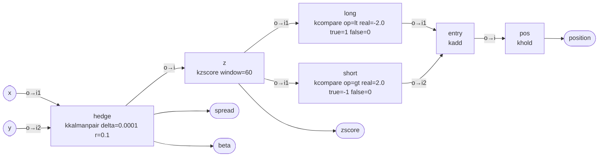

# Workspace `meanrev_kalman_pair`

Pairs mean reversion: a Kalman filter tracks the hedge ratio y = alpha + beta*x; the
one-step prior spread is z-scored over a trailing window; enter short the spread above +2,
long below -2; the position is held until the opposite signal.

**Mode:** stream · **Inputs:** x, y · **Outputs:** position, zscore, spread, beta

## Graph



## Nodes

| node | operator | parameters | why | streamable | own lag | cumulative lag |
|---|---|---|---|---|---|---|
| hedge | FINANCE:kkalmanpair — Kalman dynamic hedge ratio (prior spread o, beta o2, alpha o3). | -delta 0.0001, -r 0.1 | dynamic hedge ratio; spread uses the prior estimate (no look-ahead) | yes | spread uses the one-step prior: no look-ahead; beta adapts with time constant ~ r/(delta * var(x)) | 0.00 |
| z | FINANCE:kzscore — Trailing-window z-score. | -window 60 | normalise the spread over the last 60 bars | yes | (n-1)/2 for the mean estimate | 29.50 |
| short | DATAMANIP:kcompare — Comparison (eq, ne, lt, le, gt, ge) -> -true/-false values. | -op gt, -real 2.0, -true -1, -false 0 | spread rich -> short the spread | yes | 0 | 29.50 |
| long | DATAMANIP:kcompare — Comparison (eq, ne, lt, le, gt, ge) -> -true/-false values. | -op lt, -real -2.0, -true 1, -false 0 | spread cheap -> long the spread | yes | 0 | 29.50 |
| entry | DATAMANIP:kadd — i1 + i2 (or + -real constant). | — | combine entry events (+1 / -1 / 0) | yes | 0 (pointwise) | 29.50 |
| pos | FINANCE:khold — Hold last non-zero event (events -> position). | — | hold the last entry until the opposite one | yes | 0 | 29.50 |

## Latency

- `position`: approximately **29.50 samples** behind the input (sum of group delays along the slowest path).
- `zscore`: approximately **29.50 samples** behind the input (sum of group delays along the slowest path).
- `spread`: approximately **0.00 samples** behind the input (sum of group delays along the slowest path).
- `beta`: approximately **0.00 samples** behind the input (sum of group delays along the slowest path).

Lag figures are low-frequency group-delay approximations; true delay depends on the signal spectrum.

## Caveats

- kkalmanpair: cointegration is not tested
- kkalmanpair: early samples (burn-in) are unreliable
- kzscore: outputs 0 until minp samples and when std = 0
- kzscore: population std

## Validation

```
VALID: 0 error(s), 0 warning(s)
  lag[position] = 29.50 samples
  lag[zscore] = 29.50 samples
  lag[spread] = 0.00 samples
  lag[beta] = 0.00 samples
```

## Verification (synthetic replay)

- samples: 2000
- stream_vs_batch_max_abs_diff: 0.0
- nan_pattern_mismatch: []
- lookahead_violations: []
- output_lag_samples: {'position': '29.50', 'zscore': '29.50', 'spread': '0.00', 'beta': '0.00'}
- passed: True
