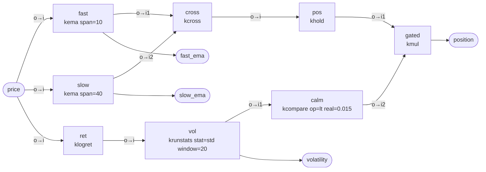

# Workspace `trend_ema_vol`

Trend following: long when the fast EMA is above the slow EMA, short when below
(position held between crossings), and flat whenever short-term volatility is high.

**Mode:** stream · **Inputs:** price · **Outputs:** position, fast_ema, slow_ema, volatility

## Graph



## Nodes

| node | operator | parameters | why | streamable | own lag | cumulative lag |
|---|---|---|---|---|---|---|
| fast | SIGNAL:kema — Exponential moving average. | -span 10 | fast trend estimate; ~4.5-bar lag | yes | (1-alpha)/alpha = (N-1)/2 samples at low frequency | 4.50 |
| slow | SIGNAL:kema — Exponential moving average. | -span 40 | slow trend estimate; ~19.5-bar lag sets the template's latency | yes | (1-alpha)/alpha = (N-1)/2 samples at low frequency | 19.50 |
| ret | FINANCE:klogret — Log return ln(x_t/x_{t-1}). | — | log returns for volatility | yes | 1/2 sample (first difference of log price) | 0.50 |
| cross | SIGNAL:kcross — Crossover events: +1 when i1 crosses above i2, -1 below. | — | +1 / -1 events when fast crosses slow | yes | 0 (inherits the lag of its inputs) | 19.50 |
| vol | SIGNAL:krunstats — Running statistic (cumulative or trailing window). | -stat std, -window 20 | 20-bar realised volatility of returns | yes | (n-1)/2 for a trailing window of n; cumulative is unbounded (grows with t) | 10.00 |
| pos | FINANCE:khold — Hold last non-zero event (events -> position). | — | turn crossing events into a held +1 / -1 position | yes | 0 | 19.50 |
| calm | DATAMANIP:kcompare — Comparison (eq, ne, lt, le, gt, ge) -> -true/-false values. | -op lt, -real 0.015 | 1 when volatility is below 1.5% per bar, else 0 | yes | 0 | 10.00 |
| gated | DATAMANIP:kmul — i1 * i2 (or * -real). | — | position times calm-market filter | yes | 0 | 19.50 |

## Latency

- `position`: approximately **19.50 samples** behind the input (sum of group delays along the slowest path).
- `fast_ema`: approximately **4.50 samples** behind the input (sum of group delays along the slowest path).
- `slow_ema`: approximately **19.50 samples** behind the input (sum of group delays along the slowest path).
- `volatility`: approximately **10.00 samples** behind the input (sum of group delays along the slowest path).

Lag figures are low-frequency group-delay approximations; true delay depends on the signal spectrum.

## Caveats

- kema: seeded with the first sample (adjust=False convention)
- kema: lag grows linearly with span
- klogret: inputs must be > 0
- kcross: emits events, not positions: follow with khold
- krunstats: population variance (ddof=0)
- krunstats: first window-1 outputs use partial windows
- kmul: unconnected i2 with no -real multiplies by 0

## Validation

```
VALID: 0 error(s), 0 warning(s)
  lag[position] = 19.50 samples
  lag[fast_ema] = 4.50 samples
  lag[slow_ema] = 19.50 samples
  lag[volatility] = 10.00 samples
```

## Verification (synthetic replay)

- samples: 1500
- stream_vs_batch_max_abs_diff: 0.0
- nan_pattern_mismatch: []
- lookahead_violations: []
- output_lag_samples: {'position': '19.50', 'fast_ema': '4.50', 'slow_ema': '19.50', 'volatility': '10.00'}
- passed: True
