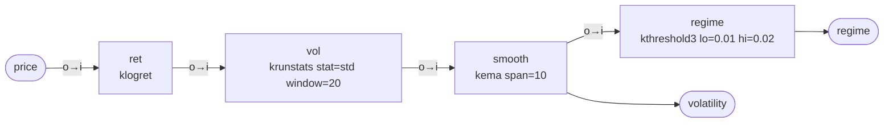

# Workspace `vol_regime`

Volatility regime labelling: 0 = calm, 1 = normal, 2 = stressed, from smoothed
20-bar realised volatility of log returns.

**Mode:** stream · **Inputs:** price · **Outputs:** regime, volatility

## Graph



## Nodes

| node | operator | parameters | why | streamable | own lag | cumulative lag |
|---|---|---|---|---|---|---|
| ret | FINANCE:klogret — Log return ln(x_t/x_{t-1}). | — | log returns | yes | 1/2 sample (first difference of log price) | 0.50 |
| vol | SIGNAL:krunstats — Running statistic (cumulative or trailing window). | -stat std, -window 20 | 20-bar realised volatility | yes | (n-1)/2 for a trailing window of n; cumulative is unbounded (grows with t) | 10.00 |
| smooth | SIGNAL:kema — Exponential moving average. | -span 10 | smooth volatility to reduce regime flicker | yes | (1-alpha)/alpha = (N-1)/2 samples at low frequency | 14.50 |
| regime | FINANCE:kthreshold3 — Three-level regime 0/1/2 by -lo/-hi. | -lo 0.01, -hi 0.02 | thresholds in return units per bar | yes | 0 | 14.50 |

## Latency

- `regime`: approximately **14.50 samples** behind the input (sum of group delays along the slowest path).
- `volatility`: approximately **14.50 samples** behind the input (sum of group delays along the slowest path).

Lag figures are low-frequency group-delay approximations; true delay depends on the signal spectrum.

## Caveats

- klogret: inputs must be > 0
- krunstats: population variance (ddof=0)
- krunstats: first window-1 outputs use partial windows
- kema: seeded with the first sample (adjust=False convention)
- kema: lag grows linearly with span
- kthreshold3: no hysteresis

## Validation

```
VALID: 0 error(s), 0 warning(s)
  lag[regime] = 14.50 samples
  lag[volatility] = 14.50 samples
```

## Verification (synthetic replay)

- samples: 1500
- stream_vs_batch_max_abs_diff: 0.0
- nan_pattern_mismatch: []
- lookahead_violations: []
- output_lag_samples: {'regime': '14.50', 'volatility': '14.50'}
- passed: True
